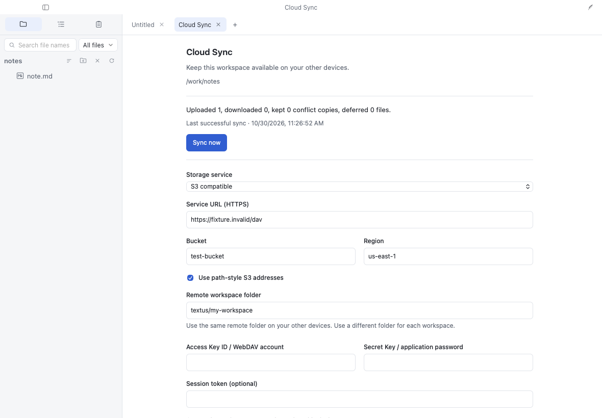
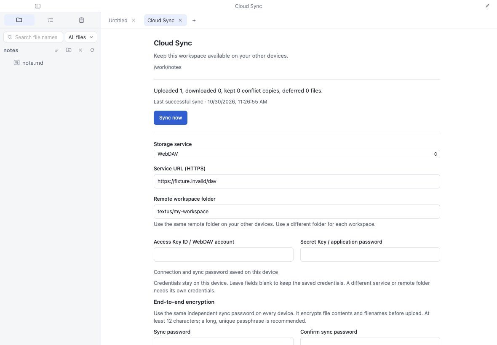
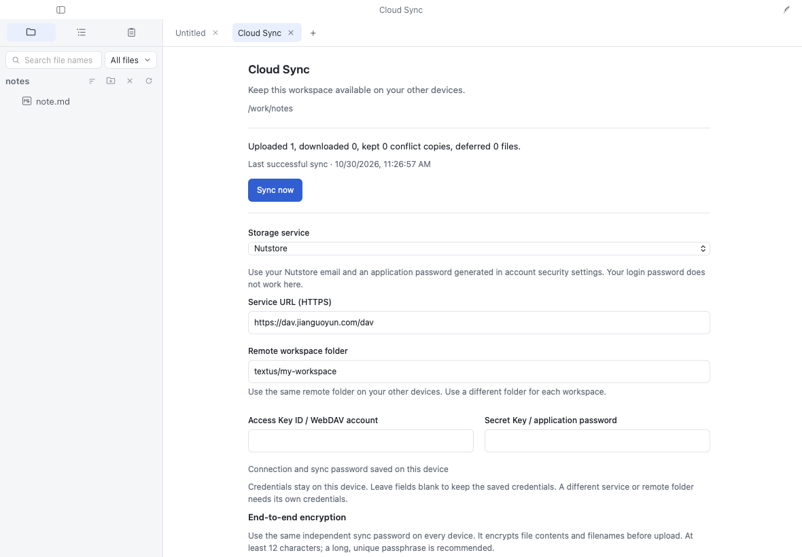
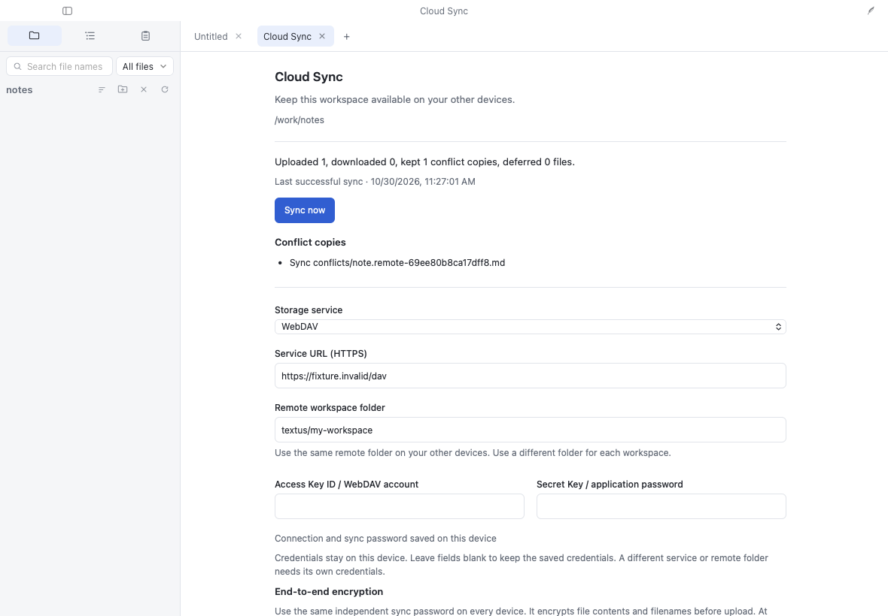
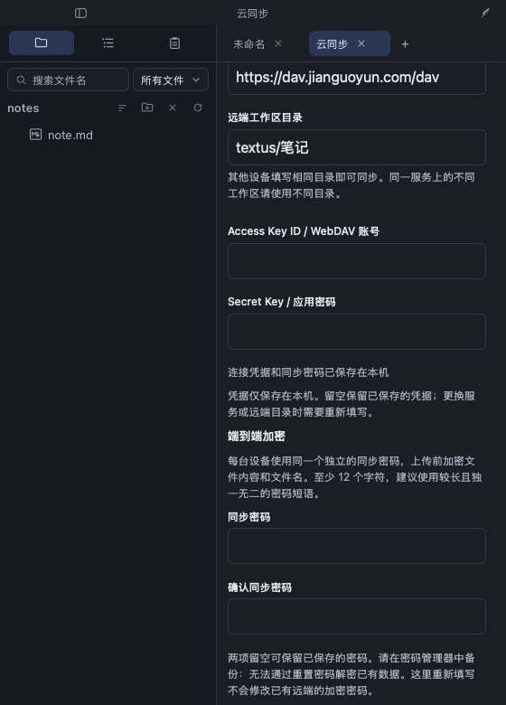
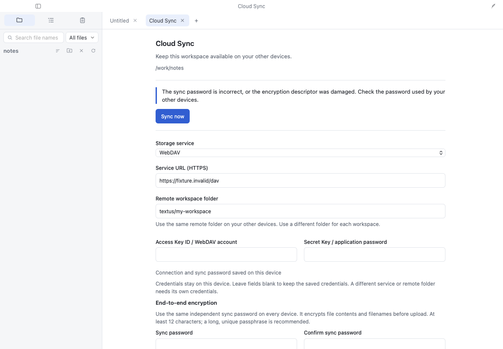
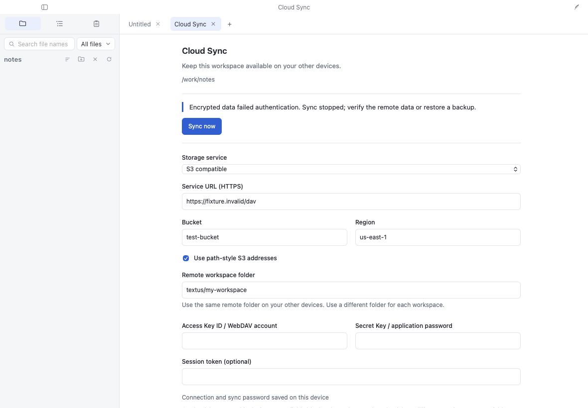

# Cloud Sync 0.2.0 validation

Validated on 2026-10-30. This report separates protocol and browser fixtures
from native installation and real service testing. All seven screenshots are
unmodified WebKit captures of the packaged plugin in Textus's actual frontend
and plugin sandbox. They demonstrate UI behavior; the tests verify encryption.

## Environment

| Component                  | Version                                                  |
| -------------------------- | -------------------------------------------------------- |
| macOS                      | 26.5.1 (25F80), Apple Silicon                            |
| Node / npm                 | 24.20.0 / 11.19.0                                        |
| Textus                     | 1.3.0-beta.6, `174de45e56a08919c0dd956c07e6895e3448044c` |
| Market repository baseline | `70c632d99bcbb6b199f001f9646518611c36e4cd`               |
| Vitest / Playwright        | 4.1.12 / 1.64.1                                          |
| Chromium / WebKit          | 156.0.8078.4 / 27.2                                      |
| Plugin                     | `ciao1019.cloud-sync` 0.2.0                              |

## Commands and results

Run from this repository unless indicated otherwise:

```sh
npm ci
npm run check
CAPTURE_EVIDENCE=1 PLAYWRIGHT_BROWSERS_PATH=/private/tmp/textus-playwright npm run test:e2e
../Textus/node_modules/.bin/prettier --check src tests scripts ui README.md README.zh.md locales.json
```

`PLAYWRIGHT_BROWSERS_PATH` is only the browser cache used on this machine;
omit it when using Playwright's default installation. The frontend checkout
defaults to `../Textus`, or set `TEXTUS_REPO`. The test runner starts its Vite
server on port 1574 and uses one worker. `PLAYWRIGHT_PORT` overrides that port.

| Check                                                  | Result                                           | Evidence                                 |
| ------------------------------------------------------ | ------------------------------------------------ | ---------------------------------------- |
| TypeScript                                             | Passed                                           | [check log](logs/plugin-check.txt)       |
| Unit and protocol tests                                | 82 passed, 7 files                               | [check log](logs/plugin-check.txt)       |
| Readable runtime consistency                           | All 5 generated files match an in-memory rebuild | [check log](logs/plugin-check.txt)       |
| Chromium integration                                   | 9 passed                                         | [integration log](logs/plugin-e2e.txt)   |
| WebKit integration                                     | 9 passed                                         | [integration log](logs/plugin-e2e.txt)   |
| Formatting                                             | Passed with Textus's Prettier                    | Command above                            |
| Market baseline `npm run check`, no community listings | 59 passed, 19 files                              | Baseline check before adding the listing |
| Market check with candidate listing                    | Blocked by upstream variable shadowing           | [failure log](logs/market-check.txt)     |

Logs preserve the test output. Local checkout paths are replaced with
`<plugin-repo>` or `<market-repo>` and terminal color codes are removed.
Timing and test outcomes are unchanged. The integration suite completed in
57.4 seconds. No real credentials appear in these artifacts.

### Unit and protocol coverage

- Independent Node PBKDF2/HKDF/HMAC/AES-GCM interoperability; fresh nonces;
  authentication of ciphertext, nonce, object identity and repository context.
- Wrong passwords, invalid KDF parameters, damaged or changed descriptors,
  missing pinned descriptors, cross-repository substitution and plaintext
  legacy repository rejection. Old clients reject the encrypted descriptor.
- Ciphertext-only cloud objects, keyed block names, deduplication, two-device
  conflicts, interrupted initialization and encrypted binary round trips
  spanning the 2 MiB block boundary.
- Real localhost HTTP protocol fixtures for S3 signing and conditional
  creation, DAV MOVE exclusion (including Nutstore's 409), redacted auth
  failures, bounded retries and rate-limit headroom for lock cleanup.
- Publish-head-last and baseline ordering, incomplete uploads, cancellation,
  lock loss, path/case collisions, content checksums, concurrent local edits,
  open files and durable interrupted binary reservations.
- Workspace/remote isolation, secret storage and password confirmation rules.

### Browser integration coverage

Each of nine flows runs in both engines. The package's actual `host.js`, panel
and manifest run through Textus's sandbox and broker. Only the native
`plugin_http` boundary is redirected to an in-memory HTTP response fixture;
the workspace uses Textus's development filesystem fixture. There is no
external cloud traffic, including when the Nutstore URL appears on screen.

- Each of S3, WebDAV and Nutstore saves secrets, tests its connection, syncs
  encrypted data and reports no changes on a second sync. Assertions reject
  plaintext filenames/content/passwords in remote objects and credentials in
  ordinary plugin state. These three flows also assert no page errors.
- Two independent browser contexts exchange edits, retain a conflict copy and
  converge to the same file contents.
- Chinese invalid configuration retains input; dark 560 x 780 layout has no
  horizontal overflow; a 403 reports an actionable error.
- Enter saves settings; the automatic interval runs with Playwright's clock.
- A wrong password leaves cloud objects and the second workspace unchanged;
  correcting it downloads the first device's document.
- A tampered encrypted manifest fails authentication before any local write.
- Password mismatch retains input; v0.1 plaintext storage is refused unchanged.

## Screenshot evidence

All accounts and workspaces are test fixtures. Desktop captures are
1180 x 820; the Chinese dark capture is 560 x 780. Screenshots were visually
checked for readable states and accidental private data.

### S3 encrypted upload

The successful run uploads one file; the test additionally inspects the remote
bytes to ensure the filename, content and sync password are absent.



### WebDAV encrypted upload



### Nutstore configuration and encrypted upload

The preset URL is shown; requests are intercepted by the fixture, not sent to
Nutstore. This is not evidence of a live Nutstore account test.



### Concurrent edits keep both versions

The conflict result names the saved copy. Assertions compare both devices'
files and verify that both edits survive.



### Chinese, dark mode, narrow encryption settings

Saved credential and password fields are blank. Encryption and password
recovery guidance stays readable at the narrow viewport.



### Wrong password stops sync



### Tampering stops sync



## Native macOS verification

Before preparing this report, the plugin was installed from its ZIP through
the real plugin installation dialog in an isolated **Textus Sync Preview**
debug app, using a demo workspace and a separate bundle identifier
`com.catvinci.textus.cloudsync-preview`. The updated encryption fields and
guidance rendered in WKWebView. No production Textus data or cloud credentials
were used. All five installed runtime files were compared byte for byte with
this release's files and matched.

The native build command was:

```sh
npm run tauri build -- --debug --bundles app --config '{"identifier":"com.catvinci.textus.cloudsync-preview","productName":"Textus Sync Preview"}'
```

It produced the runnable app bundle but exited 1 afterward because the updater
signing private key was absent. This is not a successful signed release build.
The Mac was locked when collecting this report, so no native screenshot was
captured; the screenshots above are explicitly browser integration evidence.

## Release verification

Runtime JavaScript is readable and checked in at the root with the TypeScript
source. There is no compilation between the tag and installation package.
`npm run package -- --verify-tag` verifies all nine ZIP entries against
`v0.2.0`. The package has no native programs, remote scripts or telemetry.
The only bundled runtime dependency is `aws4fetch` 1.0.20, with its source and
MIT text in `THIRD_PARTY_NOTICES.md`.

Adding the first community listing exposes an existing upstream build error:
`ReferenceError: Cannot access 'file' before initialization` at `scripts/build.mjs:273`.
The release-asset variable shadows the loop variable. The separate [fix PR #12](https://github.com/CatVinci-Studio/textus-plugins/pull/12)
adds a regression test. Its `npm run check` passes 60 tests across 20 files,
and its full `npm run build` passes for the existing catalog.
The regression executes both check-only and full package builds against an
isolated community release fixture. No CI or test-setup rules are changed.

The listing PR records the release ZIP SHA-256 and the official community
review result. A maintainer must add that reviewed SHA-256 to the listing.
Do not replace the release asset or move its tag.

## Remaining validation and limitations

- No live AWS/S3-compatible, WebDAV or Nutstore account was tested. Actual
  provider limits and deployment-specific behavior still need verification.
- No independent cryptographic audit. The service can observe object sizes,
  counts, timing and block reuse. Malicious replay of old authenticated state
  is not guaranteed to be detected. Local files remain readable.
- No Windows, Linux or iOS native run was performed; automated WebKit is not
  an iOS device test. The Textus application repository is unchanged; its full
  `check:all` suite was not rerun for this external plugin listing.
- Deletion propagation, remote garbage collection, in-place key rotation and
  single-snapshot restore UI are not implemented. Binary changes keep both
  versions; open destination files are deferred.
- Existing v0.1 plaintext storage requires a fresh empty prefix; old remote
  objects and provider history are not retroactively encrypted or deleted.
- `network:*` is necessary for arbitrary user-configured HTTPS storage hosts,
  but conflicts with the market's current open-web-only permission policy.
  The listing remains a draft for a maintainer decision. Passing automated
  checks is not market approval or a security audit.
